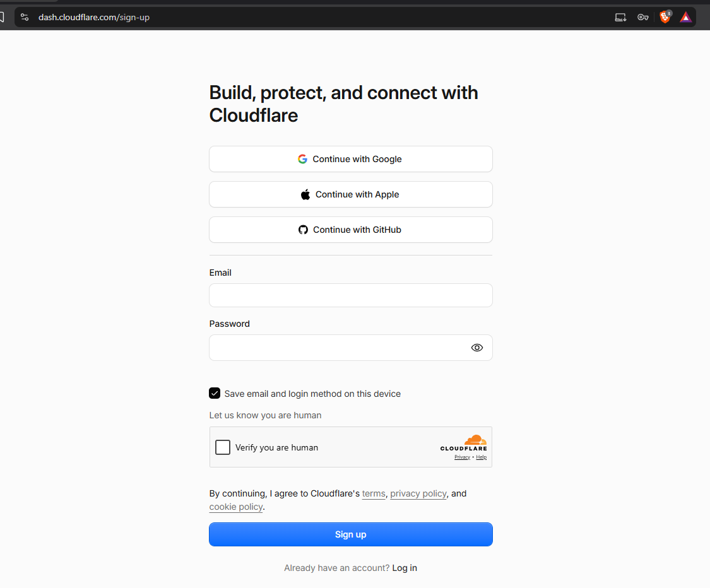
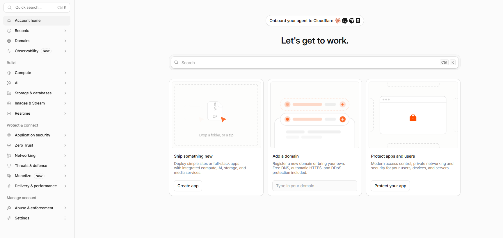
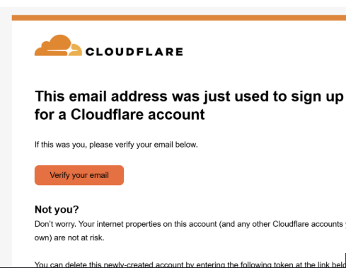
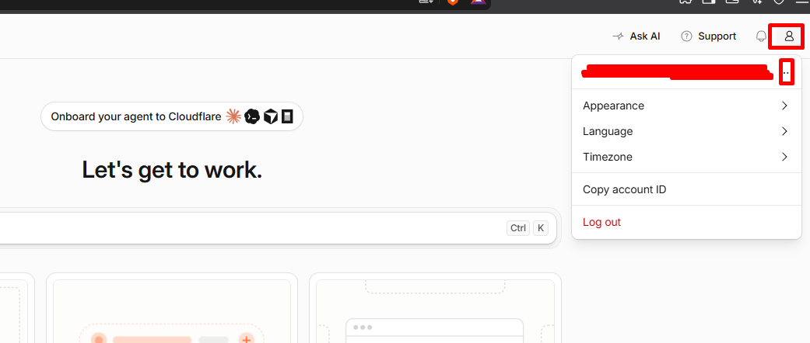
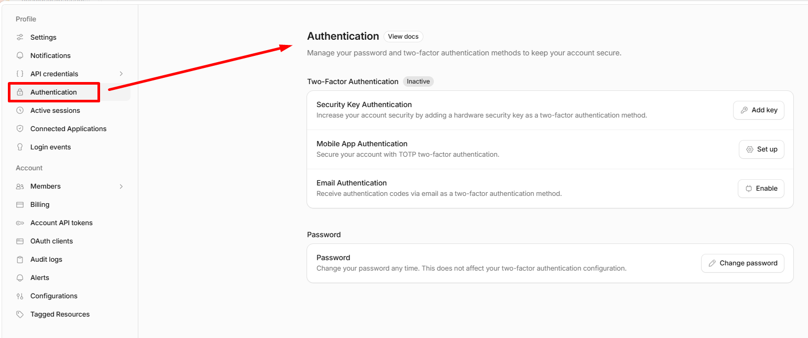
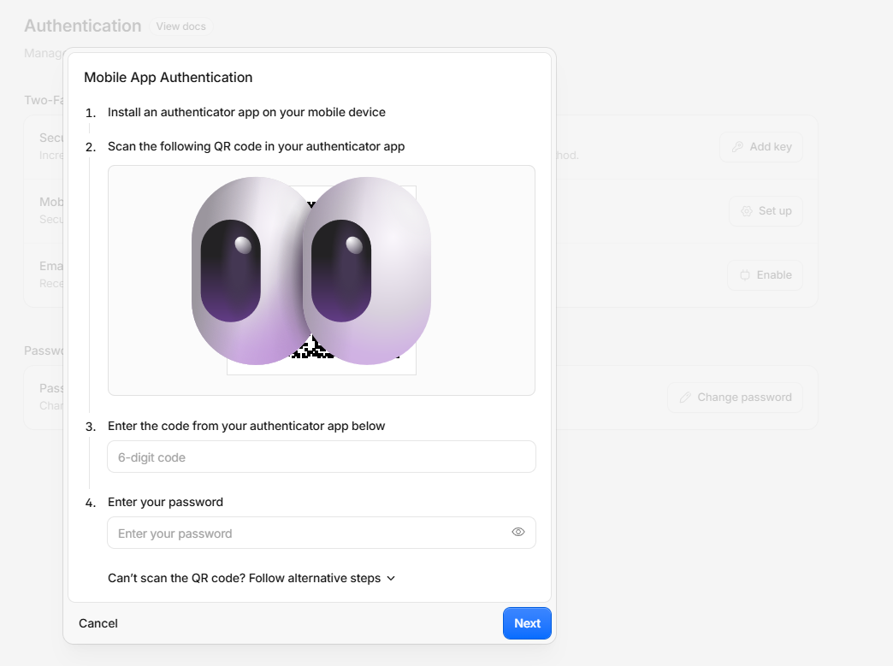

# 01. Crear la cuenta

[Índice](README.md) · [02. Comprar el dominio →](02-comprar-el-dominio.md)

---

## Registrarse

1. Entra a https://dash.cloudflare.com/sign-up.
2. Escribe tu **Email** y una **Password**. Usa un correo al que tengas
   acceso: lo vas a necesitar para verificar la cuenta y el dominio.
3. Pulsa **Create Account** (o **Sign up**).

   > 

4. Si Cloudflare te pregunta para qué vas a usar la cuenta o qué plan quieres,
   elige el plan **Free**. Todo lo de esta guía es gratis, salvo el dominio.

   > 

## Verificar el email

Cloudflare te manda un correo apenas creas la cuenta.

1. Abre el correo de Cloudflare. Si no aparece, revisa la carpeta de spam.
2. Pulsa el enlace de verificación.
3. Vuelve a entrar a Cloudflare. El aviso de «verifica tu email» del panel
   desaparece.

   > 

> Sin el email verificado no puedes activar 2FA, y la compra del dominio
> también lo pide.

## Activar la autenticación en dos pasos (2FA)

La cuenta va a controlar el dominio de tu proyecto: si alguien entra, puede
apuntarlo a otro servidor. Protégela con 2FA.

1. En el panel, abre el menú de tu perfil (arriba a la derecha) y elige
   **My Profile**.
2. Entra a **Authentication**.

   > 

   > 

3. Junto a **Mobile App Authentication**, pulsa **Add** y escanea el código
   QR con una app de autenticación (Google Authenticator, Microsoft
   Authenticator, Authy o similar).
4. Escribe el código de 6 dígitos que muestra la app para confirmarlo.
5. **Guarda los códigos de recuperación** (*backup codes*) en un lugar seguro.
   Si pierdes el teléfono, son la única forma de volver a entrar.

   > 

---

[Índice](README.md) · [02. Comprar el dominio →](02-comprar-el-dominio.md)
