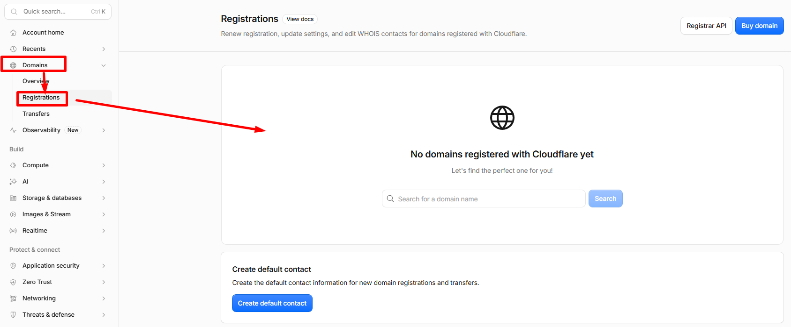
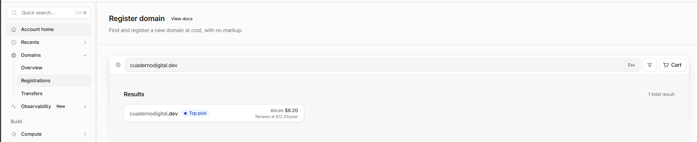
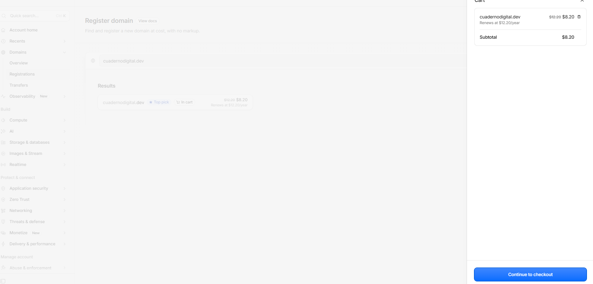
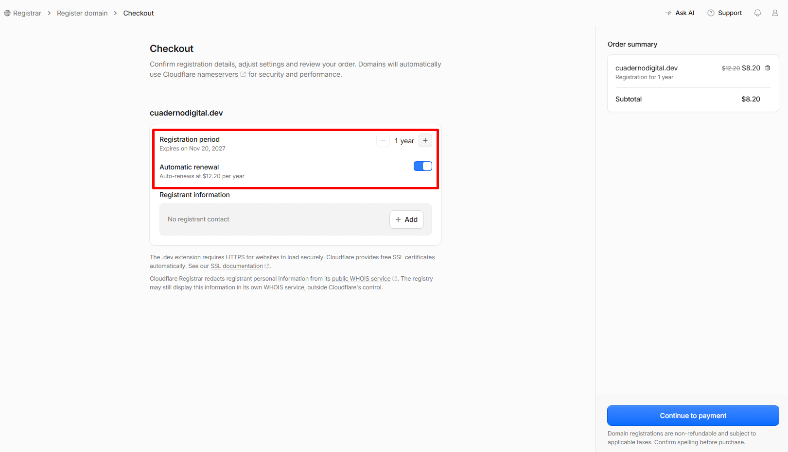
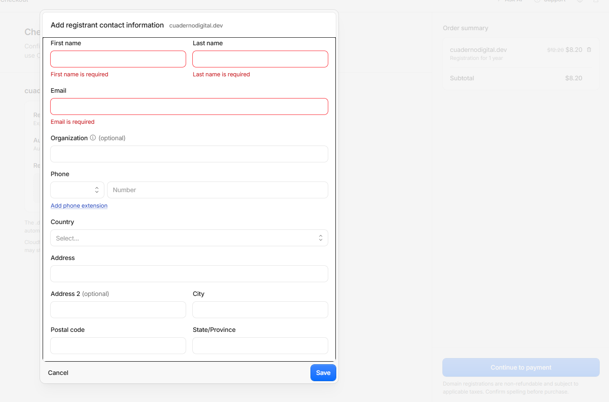
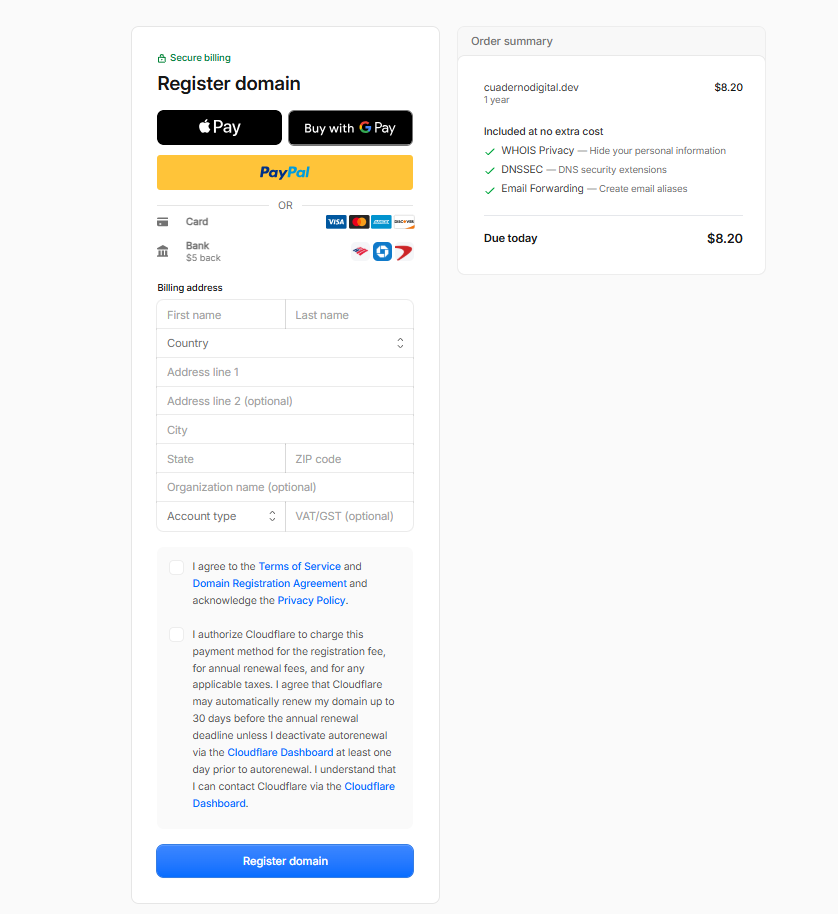
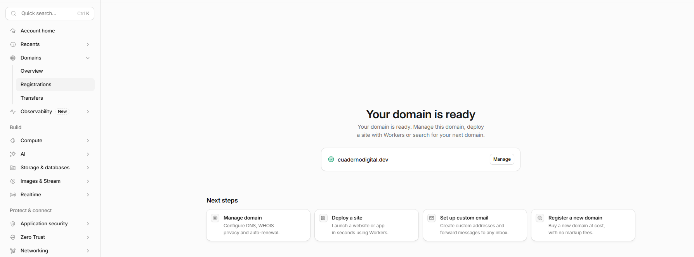
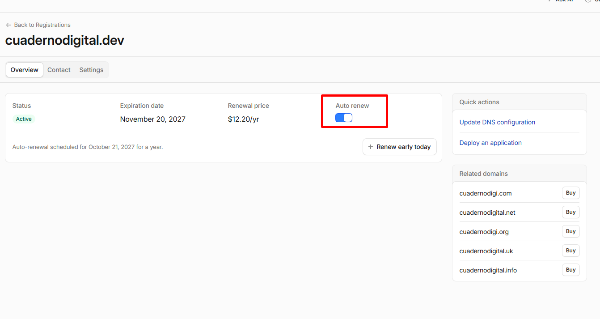
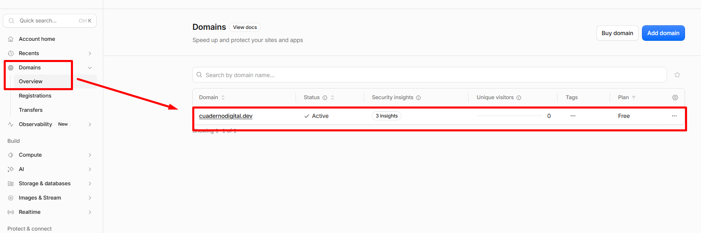

# 02. Comprar el dominio

[← 01. Crear la cuenta](01-crear-la-cuenta.md) · [Índice](README.md) · [03. Crear los registros DNS →](03-registros-dns.md)

---

Cloudflare Registrar vende los dominios **a precio de costo**: lo que cobran el
registro del TLD (`.com`, `.dev`…) y la ICANN, sin recargo. El precio depende
del TLD, y Cloudflare lo muestra antes de pagar.

## Antes de comprar

- **Método de pago:** necesitas una tarjeta (o el medio que acepte Cloudflare
  en tu país). El dominio es lo único que se paga en todo el despliegue,
  aparte del VPS.
- **Datos de contacto:** el registro de un dominio pide nombre, dirección y
  email del titular (*registrant*). Cloudflare los oculta en el WHOIS público.
- **Si el curso lo hace en grupo,** acuerden quién compra el dominio y en qué
  cuenta queda. El dueño de la cuenta es el dueño del dominio.

## Buscar y comprar

1. En el panel de Cloudflare, en el menú lateral, entra a
   **Domain Registration → Register Domains** (o **Registrar → Register**).

   > 

2. Escribe el nombre que quieres en el buscador y pulsa **Search**. También
   puedes escribir palabras clave para ver sugerencias. Si el nombre que
   buscaste no aparece en los resultados, no está disponible.

   > 
   

3. Pulsa **Purchase** en el dominio que elijas. Cloudflare comprueba otra vez
   que esté disponible.

   > 

4. En **Payment option**, elige por cuántos años lo registras. Para el curso
   basta con **1 año**. La fecha de vencimiento y el precio se actualizan
   solos.

   > 
   

5. Completa los datos de contacto del titular y el método de pago.

   > 

6. Revisa el resumen y confirma la compra.

   > 

   > 

## Después de comprar

- **Renovación automática:** viene **activada**. Al año, Cloudflare cobra la
  renovación al precio de lista del registro. Si el dominio es solo para el
  curso y no quieres renovarlo, desactívala en la página del dominio
  (**Manage domain → Auto-renew**).

  > 
  

- **Verificación del email de contacto:** si el email del titular no es el de
  tu cuenta de Cloudflare, te llega otro correo de verificación. **Hay que
  verificarlo en 15 días.** Si no, el dominio queda retenido y deja de
  resolver hasta que lo verifiques.
- **El dominio aparece en tu cuenta** en **Websites** (o **Domains**), ya con
  el DNS de Cloudflare activo. No hay que cambiar *nameservers*.

  > 
  

---

[← 01. Crear la cuenta](01-crear-la-cuenta.md) · [Índice](README.md) · [03. Crear los registros DNS →](03-registros-dns.md)
