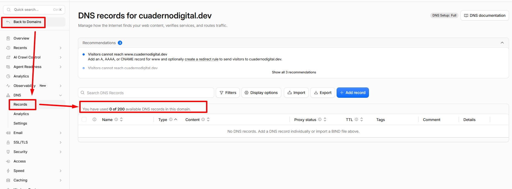
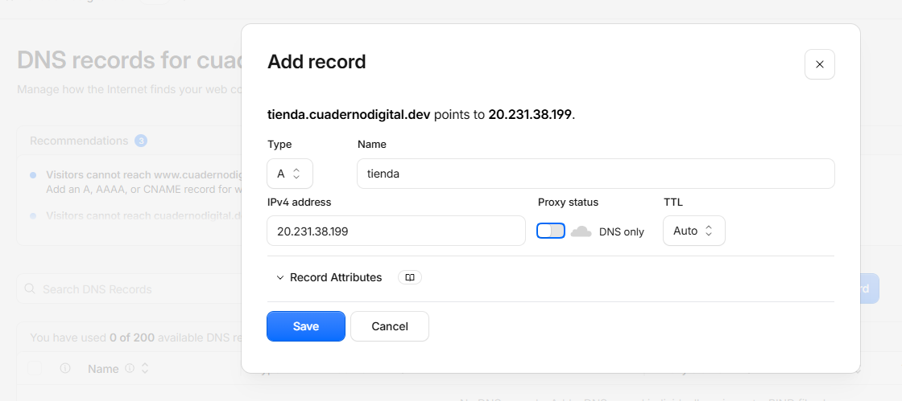
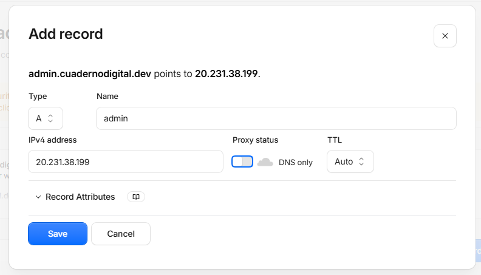
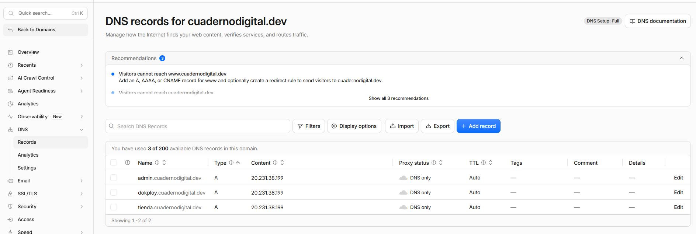

# 03. Crear los registros DNS

[← 02. Comprar el dominio](02-comprar-el-dominio.md) · [Índice](README.md) · [04. Comprobar que el dominio resuelve →](04-comprobar.md)

---

Necesitas la **IP pública de tu VPS**
([`docs/dokploy/02-vps-y-dns.md`](../dokploy/02-vps-y-dns.md)). Los ejemplos
usan `203.0.113.10`: reemplázala por la tuya.

## Los registros

Vas a crear tres registros **A**, uno por subdominio:

| Type | Name | IPv4 address | Proxy status | TTL |
|---|---|---|---|---|
| `A` | `tienda` | IP del VPS | **DNS only** (nube gris) | Auto |
| `A` | `admin` | IP del VPS | **DNS only** (nube gris) | Auto |
| `A` | `dokploy` | IP del VPS | **DNS only** (nube gris) | Auto |

En **Name** va solo el subdominio: `tienda`, no `tienda.tu-dominio.com`.
Cloudflare le agrega el dominio.

**¿Por qué DNS only?** Así el navegador llega directo a tu VPS y Let's
Encrypt, desde Dokploy, emite los certificados sin intermediarios. Activar el
proxy de Cloudflare (nube naranja) es opcional, y conviene hacerlo **después**
de que todo funcione: ver [05. Proxy y SSL](05-proxy-y-ssl-opcional.md).

## Crear cada registro

1. En el panel, entra a tu dominio (**Websites** → tu dominio) y abre
   **DNS → Records**.

   > 

2. Pulsa **Add record**.
3. Completa:
   - **Type:** `A`
   - **Name:** `tienda`
   - **IPv4 address:** la IP del VPS
   - **Proxy status:** apágalo, para que quede la nube gris y diga
     **DNS only**
   - **TTL:** `Auto`

   > 
   

4. Pulsa **Save**.
5. Repite los pasos 2 a 4 para `admin` y `dokploy`.

   > 

   > 

   > 
   
### Alternativa: un solo registro comodín

En vez de los tres, puedes crear un registro con `*` en **Name**. Así,
cualquier subdominio (`tienda`, `admin`, `dokploy` o uno nuevo) apunta al VPS:

| Type | Name | IPv4 address | Proxy status |
|---|---|---|---|
| `A` | `*` | IP del VPS | DNS only |

Es cómodo, pero menos explícito: también resuelven subdominios que no usas.
Para el curso, los tres registros son más claros.

## Si cambias de VPS

Edita los tres registros (el lápiz de cada fila) y pon la IP nueva. Con TTL
`Auto`, el cambio llega en pocos minutos.

---

[← 02. Comprar el dominio](02-comprar-el-dominio.md) · [Índice](README.md) · [04. Comprobar que el dominio resuelve →](04-comprobar.md)
