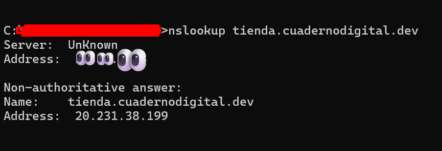

# 04. Comprobar que el dominio resuelve

[← 03. Crear los registros DNS](03-registros-dns.md) · [Índice](README.md) · [05. Proxy y SSL de Cloudflare (opcional) →](05-proxy-y-ssl-opcional.md)

---

Antes de instalar Dokploy o configurar los dominios en el panel, comprueba
que cada subdominio ya apunta a tu VPS.

## Desde tu equipo

**Windows** (PowerShell o CMD), **macOS** o **Linux**:

```bash
nslookup tienda.<tu-dominio>
nslookup admin.<tu-dominio>
nslookup dokploy.<tu-dominio>
```

Cada respuesta debe terminar con la IP de tu VPS.

### Ejemplo real: `cuadernodigital.dev`

El despliegue de referencia del curso usa el dominio `cuadernodigital.dev`,
con su VPS en `20.231.38.199`. Así se ve la comprobación en Windows:

```text
C:\Users\...> nslookup tienda.cuadernodigital.dev
Server:  UnKnown
Address:  10.x.x.x

Non-authoritative answer:
Name:    tienda.cuadernodigital.dev
Address:  20.231.38.199
```

Cómo leerla:

- **`Server` / `Address` (arriba):** el servidor DNS de **tu red**, el que
  hizo la consulta por ti. Cambia según dónde estés conectado (casa,
  universidad, oficina). `UnKnown` solo significa que ese servidor no tiene
  nombre inverso; no es un error.
- **`Non-authoritative answer`:** la respuesta no viene directo de Cloudflare,
  sino del DNS de tu red, que la tenía guardada. Es lo normal.
- **`Name` / `Address` (abajo):** lo que importa. El subdominio y la IP a la
  que apunta, que debe ser la de **tu** VPS.

> 


**Comprueba también contra un DNS público.** Así descartas que tu red tenga
guardada una respuesta vieja. Se agrega la dirección del DNS al final;
`1.1.1.1` es el de Cloudflare:

```bash
nslookup tienda.<tu-dominio> 1.1.1.1
```

Resultado de los tres subdominios de `cuadernodigital.dev` contra `1.1.1.1`:

```text
tienda.cuadernodigital.dev   20.231.38.199
admin.cuadernodigital.dev    20.231.38.199
dokploy.cuadernodigital.dev  20.231.38.199
```

Los tres apuntan a la misma IP: todo el tráfico llega al mismo VPS, y es
Traefik, desde Dokploy, el que decide a qué aplicación va cada subdominio.

En macOS o Linux también sirve `dig +short tienda.<tu-dominio>`, que imprime
solo la IP.

## Si todavía no resuelve

| Síntoma | Causa probable | Qué hacer |
|---|---|---|
| `Non-existent domain` o `NXDOMAIN` justo después de comprar | El dominio recién registrado aún se está activando | Espera unos minutos y vuelve a probar |
| Resuelve a otra IP | El registro tiene la IP equivocada, o tu red guarda una respuesta vieja | Revisa el registro en **DNS → Records**; prueba con `nslookup tienda.<tu-dominio> 1.1.1.1` |
| Resuelve a IPs de Cloudflare, no a la de tu VPS | El registro quedó en **Proxied** (nube naranja) | Cámbialo a **DNS only** ([paso 03](03-registros-dns.md)) |
| Dejó de resolver días después de la compra | No verificaste el email de contacto del dominio | Busca el correo de verificación ([paso 02](02-comprar-el-dominio.md#después-de-comprar)) |

## Siguiente

Con los tres subdominios resolviendo, sigue con la instalación de Dokploy:
[`docs/dokploy/03-instalar-dokploy.md`](../dokploy/03-instalar-dokploy.md).

---

[← 03. Crear los registros DNS](03-registros-dns.md) · [Índice](README.md) · [05. Proxy y SSL de Cloudflare (opcional) →](05-proxy-y-ssl-opcional.md)
