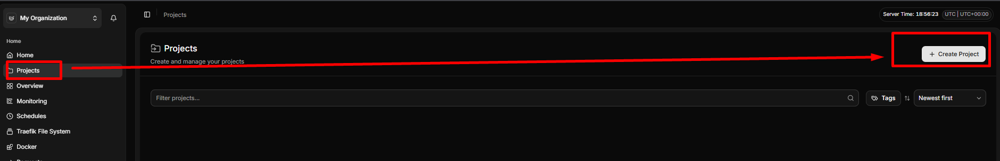
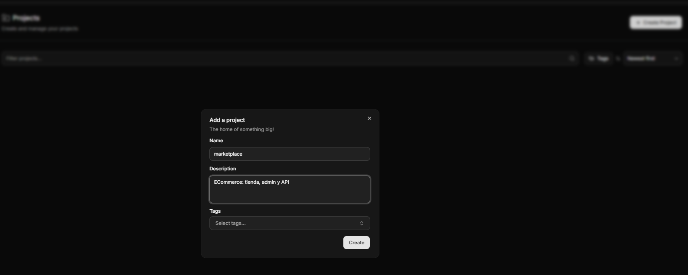
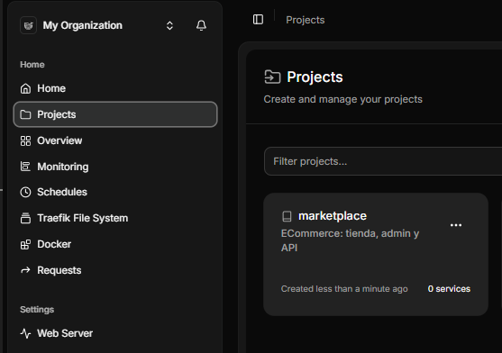
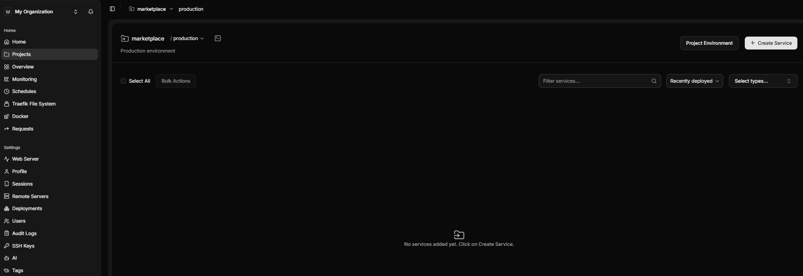

# 04. Crear el proyecto marketplace

[← 03. Instalar Dokploy](03-instalar-dokploy.md) · [Índice](README.md) · [05. Crear el Compose →](05-crear-el-compose.md)

---

En Dokploy, un **proyecto** agrupa los servicios de una misma aplicación. El de
esta guía se llama **`marketplace`** y va a contener un solo servicio: el
Compose del paso siguiente, con todo el stack (Postgres, API, tienda, admin y
los dos Caddy).

Un proyecto propio mantiene separados sus
servicios, sus variables y sus despliegues, y se puede borrar entero sin tocar
lo demás.

## Crear el proyecto

1. En el menú lateral, entra a **Projects**.

   >    

2. Pulsa **Create Project** (o **+ Project**).
3. Completa:
   - **Name:** `marketplace`
   - **Description** (opcional): por ejemplo, «ECommerce: tienda, admin y API».

   > 
   

4. Pulsa **Create**. El proyecto aparece en la lista, todavía sin servicios.

   > 
   

5. Entra al proyecto `marketplace`. Dokploy crea un entorno por defecto
   (**production**): ahí va el Compose del paso siguiente.

   >    

## Un nombre, varios lugares

`marketplace` es solo el nombre del proyecto en el panel. No cambia nada del
código:

| Dónde | Nombre |
|---|---|
| Proyecto en Dokploy | `marketplace` |
| Repositorio en GitHub | tu fork (por ejemplo, `<tu-usuario>/safari-marketplace`) |
| Imágenes en Docker Hub | `<usuario>/safari-api`, `safari-shop`, `safari-admin`, `safari-db-init` y `safari-proxy` |
| Dominios | `tienda.<tu-dominio>` y `admin.<tu-dominio>` |

---

[← 03. Instalar Dokploy](03-instalar-dokploy.md) · [Índice](README.md) · [05. Crear el Compose →](05-crear-el-compose.md)
