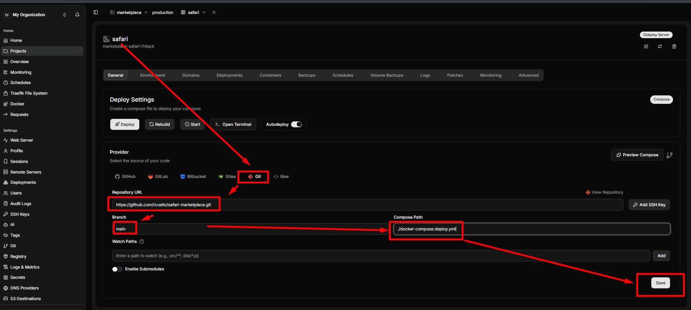
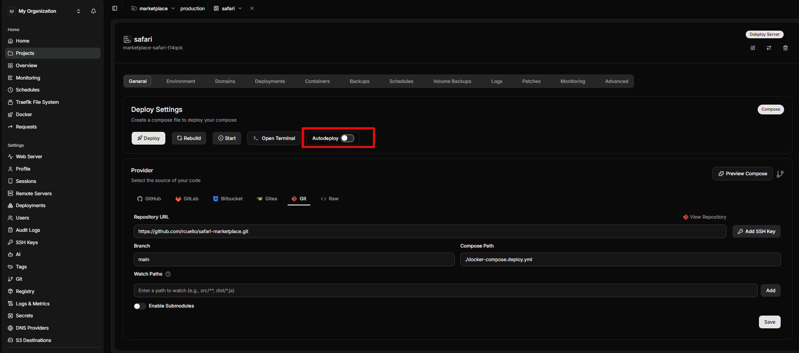

# 05. Crear el Compose

[← 04. Crear el proyecto marketplace](04-crear-el-proyecto.md) · [Índice](README.md) · [06. Cargar las variables →](06-variables.md)

---

El **Compose** es el servicio que levanta todo el stack de Safari a partir del
archivo `docker-compose.deploy.yml` de tu fork. Dokploy clona el repositorio en
cada despliegue y ejecuta ese archivo.

## Crear el servicio

1. Dentro del proyecto `marketplace`, en el entorno **production**
   ([paso 04](04-crear-el-proyecto.md)), pulsa **Create Service** y elige
   **Compose**.

   > 
   

2. Completa el formulario:
   - **Name:** `safari`
   - **App Name:** déjalo como lo propone Dokploy. Es el nombre interno del
     stack en el servidor (y de su red). Dokploy le agrega un sufijo al
     final, por ejemplo `marketplace-safari-t14qck`.
   - **Compose Type:** **Docker Compose** (no *Stack*).

   Pulsa **Create**.

   > 

## Conectar el repositorio

3. En la pestaña **General**, sección del proveedor, elige **Git**. Como el
   fork es público, no hace falta conectar tu cuenta de GitHub:
   - **Repository URL:** `https://github.com/<tu-usuario>/<tu-fork>.git`
   - **Branch:** `main`
   - **Compose Path:** `./docker-compose.deploy.yml`

   Pulsa **Save**.

   > 
   

> No uses el `docker-compose.yml` de la raíz: es el de desarrollo. Construye
> las imágenes, publica puertos y trae valores de prueba.

## Ajustes del despliegue

4. **Auto Deploy:** déjalo **apagado** (está en la misma pestaña **General**).
   Despliegas tú, eligiendo la versión (`IMAGE_TAG`).

   > 

Todavía **no despliegues**: sin las variables del paso siguiente, el Compose
falla al arrancar con un mensaje que nombra la variable que falta.

---

[← 04. Crear el proyecto marketplace](04-crear-el-proyecto.md) · [Índice](README.md) · [06. Cargar las variables →](06-variables.md)
