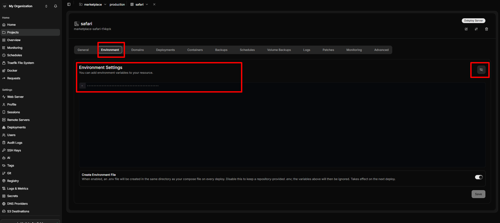

# 06. Cargar las variables

[← 05. Crear el Compose](05-crear-el-compose.md) · [Índice](README.md) · [07. Configurar los dominios →](07-dominios.md)

---

El compose de despliegue no trae ningún valor propio del entorno: todos salen
de las variables de esta pestaña. Dokploy las guarda en un archivo `.env` junto
a `docker-compose.deploy.yml`, y el compose las lee con `${VARIABLE}`.

## Preparar los valores

1. Genera tres cadenas aleatorias, en el VPS o en tu equipo. Ejecuta el
   comando una vez por cada una:

   ```bash
   openssl rand -hex 32
   ```

   Usa una para `JWT_SECRET`, otra para `SHOP_SECRET` y la tercera para
   `POSTGRES_PASSWORD`. El resultado es hexadecimal (solo letras y números),
   así que sirve también como contraseña de Postgres.

2. Copia el contenido de
   [`deploy.variables.example`](../../deploy.variables.example) (en la raíz
   del repositorio) y **cambia todos los valores**:

   | Variable | Valor |
   |---|---|
   | `DOCKERHUB_USERNAME` | tu usuario de Docker Hub |
   | `IMAGE_TAG` | la etiqueta que anotaste en [01 · Elegir la versión](01-antes-de-empezar.md#elegir-la-versión-a-desplegar), por ejemplo `sha-4fcb7f1` |
   | `SHOP_URL` | `https://tienda.<tu-dominio>`, con `https` y **sin `/` final** |
   | `JWT_SECRET` | la primera cadena aleatoria |
   | `SHOP_SECRET` | la segunda, distinta de la anterior |
   | `POSTGRES_PASSWORD` | la tercera: **solo letras y números** |

   Las líneas que empiezan con `#` son comentarios: puedes dejarlas o
   borrarlas.

## Cargarlos en Dokploy

3. En el Compose `safari`, entra a la pestaña **Environment**.

   > 

4. Pega las variables en el editor y pulsa **Save**.

   > 

> **Si vas a sacar capturas o compartir pantalla**, hazlo con los valores de
> ejemplo de la plantilla, no con los reales. La pestaña **Environment**
> muestra los secretos en texto plano.

## Cuidado con estos valores

Guárdalos en un lugar seguro y no los compartas. En particular:

- **`POSTGRES_PASSWORD` solo se aplica al crear la base.** Si la cambias
  después, la API ya no podrá conectarse. Sin símbolos, porque `@ : / # ?`
  rompen la URL de conexión.
- **Cambiar `JWT_SECRET`** cierra la sesión de todos los usuarios.
- **Si falta una variable**, el despliegue falla al empezar y el log dice
  cuál (`Falta JWT_SECRET …`).

---

[← 05. Crear el Compose](05-crear-el-compose.md) · [Índice](README.md) · [07. Configurar los dominios →](07-dominios.md)
