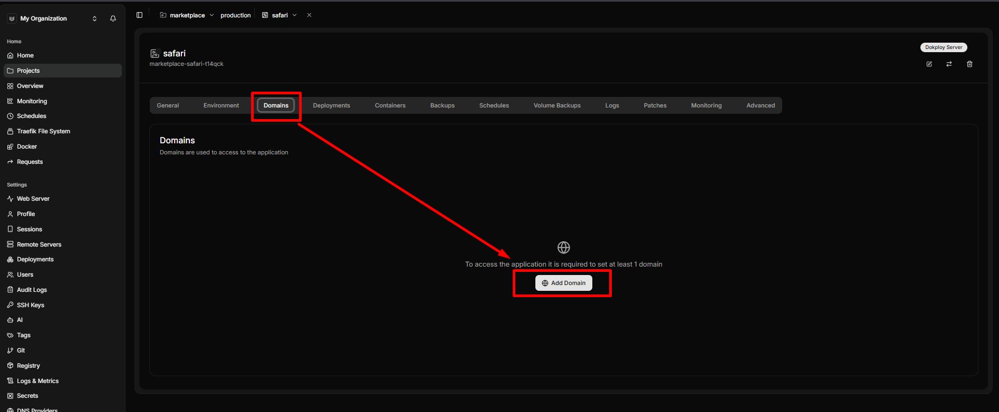
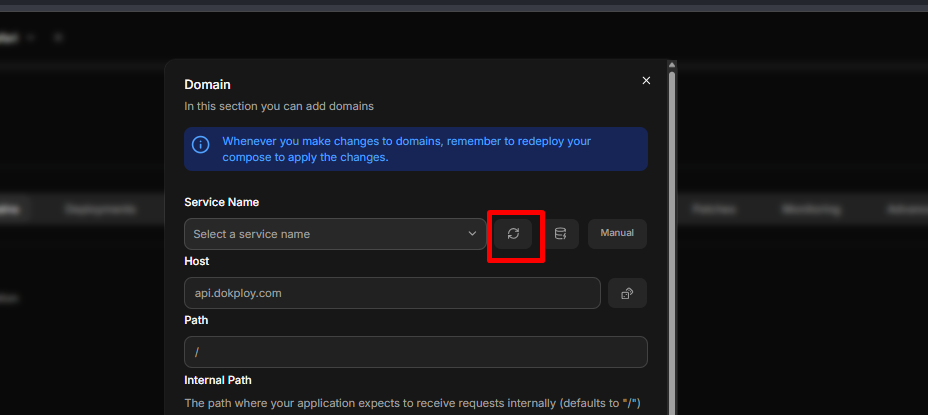
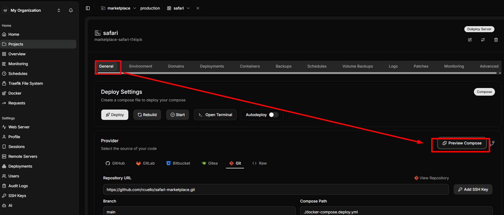

# 07. Configurar los dominios

[← 06. Cargar las variables](06-variables.md) · [Índice](README.md) · [08. Desplegar y comprobar →](08-desplegar-y-comprobar.md)

---

Safari se publica con **dos dominios**, los dos hacia el servicio **`proxy`**
del compose, cada uno con su puerto. El `proxy` (Caddy) reparte después cada
petición:

```text
https://tienda.<tu-dominio> ──▶ Traefik ──▶ proxy:3003 ─┬─▶ shop:3000
                                                        └─ /backend/* ─▶ api-lb ─▶ api
https://admin.<tu-dominio>  ──▶ Traefik ──▶ proxy:3002 ─┬─▶ admin:3000
                                                        └─ /backend/* ─▶ api-lb ─▶ api
```

**No crees un dominio para la API.** El navegador le habla por `/backend/…`
dentro del mismo dominio de la tienda o del admin, y el `proxy` lo manda a la
API.

> Antes de seguir, los registros DNS `tienda` y `admin` tienen que resolver ya
> a la IP del VPS ([paso 02](02-vps-y-dns.md#configurar-el-dns)). Si no,
> Let's Encrypt no puede emitir los certificados.

## Crear el dominio de la tienda

1. En el Compose `safari`, entra a la pestaña **Domains** y pulsa
   **Add Domain**.

   > 

2. Si el formulario muestra **«Services not found»** y la lista
   **Service Name** está vacía, pulsa el botón de **refrescar** (↻) que está
   al lado. Dokploy descarga el `docker-compose.deploy.yml` del fork y llena
   la lista con sus servicios.

   > 
   

3. Completa el formulario:

   | Campo | Valor |
   |---|---|
   | Service Name | `proxy` |
   | Host | `tienda.<tu-dominio>` |
   | Path | `/` |
   | Internal Path | `/` |
   | Strip Path | apagado |
   | Container Port | `3003` |
   | Custom Entrypoint | apagado |
   | HTTPS | activado |
   | Certificate Provider | Let's Encrypt |
   | Middlewares | vacío |

   El campo **Certificate Provider** aparece recién al activar **HTTPS**,
   debajo del interruptor. Pulsa **Create**.

   > 
   

## Crear el dominio del admin

4. Pulsa otra vez **Add Domain** y completa el formulario. Cambian solo
   **Host** y **Container Port** (en negrita):

   | Campo | Valor |
   |---|---|
   | Service Name | `proxy` |
   | Host | **`admin.<tu-dominio>`** |
   | Path | `/` |
   | Internal Path | `/` |
   | Strip Path | apagado |
   | Container Port | **`3002`** |
   | Custom Entrypoint | apagado |
   | HTTPS | activado |
   | Certificate Provider | Let's Encrypt |
   | Middlewares | vacío |

   Pulsa **Create**.

   > 

5. La pestaña **Domains** muestra los dos dominios. El botón
   **Validate DNS** de cada uno comprueba que el registro ya apunta a la IP
   del servidor.

   > 
   

## Qué hace Dokploy con esto

- **Los dominios se aplican al desplegar.** Dokploy agrega las etiquetas de
  Traefik al compose en cada despliegue, así que todavía no responden: lo
  harán después del paso 08.
- **HTTP redirige a HTTPS solo.** Con HTTPS activado, Dokploy crea también la
  redirección desde `http://`.
- **El certificado tarda unos segundos** después del primer despliegue.
  Mientras tanto, el navegador puede mostrar un aviso de certificado.

Si quieres ver el compose final que va a ejecutar Dokploy, con las etiquetas
de Traefik y la red ya añadidas, pulsa **Preview Compose** (pestaña
**General**).

> 


---

[← 06. Cargar las variables](06-variables.md) · [Índice](README.md) · [08. Desplegar y comprobar →](08-desplegar-y-comprobar.md)
