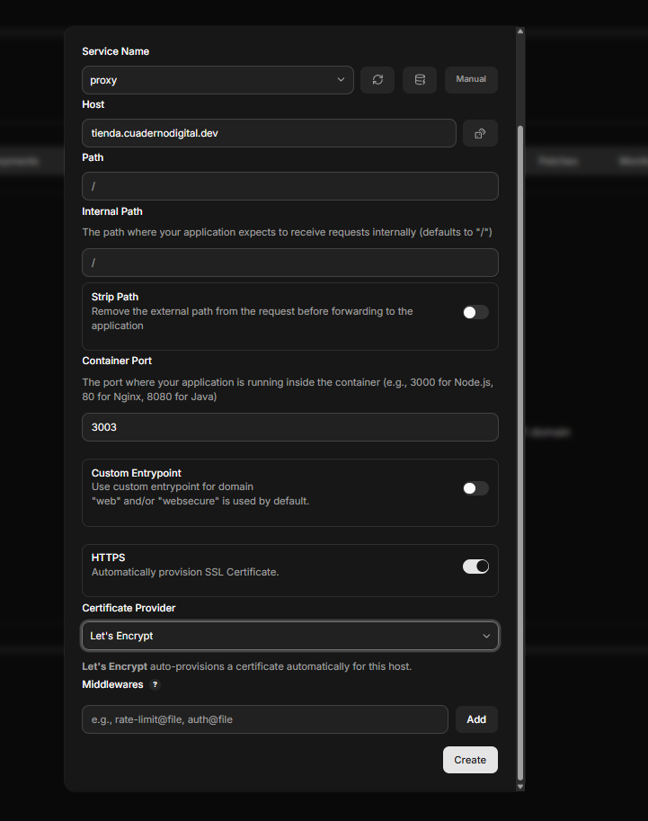
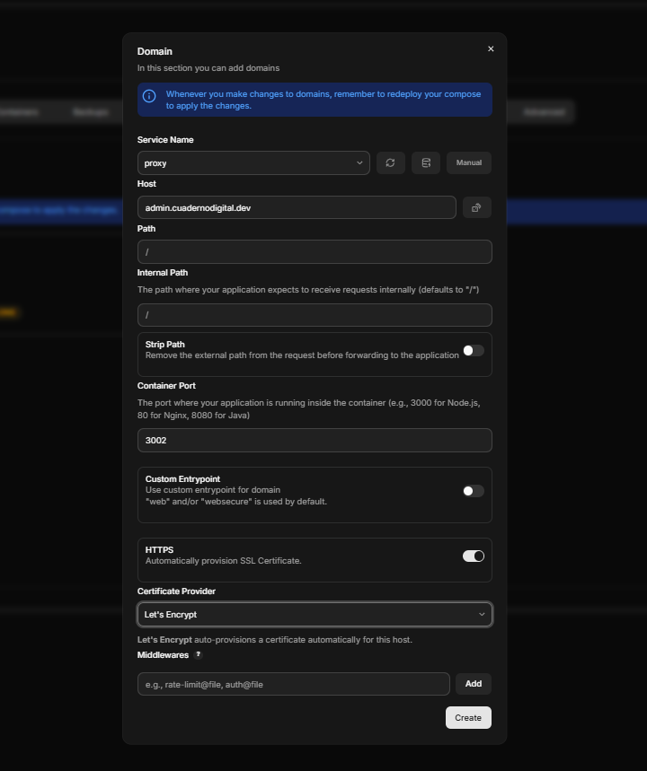
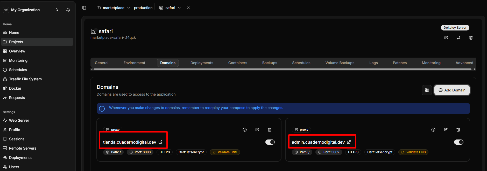

# 07. Configurar los dominios

[← 06. Cargar las variables](06-variables.md) · [Índice](README.md) · [08. Desplegar y comprobar →](08-desplegar-y-comprobar.md)

---

Safari se publica con **dos dominios**, los dos hacia el servicio **`proxy`**
del compose, cada uno con su puerto. El `proxy` (Caddy) reparte después cada
petición:

```text
https://tienda.<tu-dominio> ──▶ Traefik ──▶ proxy:3003 ─┬─▶ shop:3000
                                                        └─ /backend/* ─▶ api-lb ─▶ api
https://admin.<tu-dominio>  ──▶ Traefik ──▶ proxy:3002 ─┬─▶ admin:3000
                                                        └─ /backend/* ─▶ api-lb ─▶ api
```

**No crees un dominio para la API.** El navegador le habla por `/backend/…`
dentro del mismo dominio de la tienda o del admin, y el `proxy` lo manda a la
API.

> Antes de seguir, los registros DNS `tienda` y `admin` tienen que resolver ya
> a la IP del VPS ([paso 02](02-vps-y-dns.md#configurar-el-dns)). Si no,
> Let's Encrypt no puede emitir los certificados.

## Crear el dominio de la tienda

1. En el Compose `safari`, entra a la pestaña **Domains** y pulsa
   **Add Domain**.

   > 

2. Completa el formulario:

   | Campo | Valor |
   |---|---|
   | Service Name | `proxy` |
   | Host | `tienda.<tu-dominio>` |
   | Path | `/` |
   | Internal Path | vacío (o `/`) |
   | Strip Path | apagado |
   | Container Port | `3003` |
   | HTTPS | activado |
   | Certificate Provider | Let's Encrypt |

   Pulsa **Create**.

   > 

## Crear el dominio del admin

3. Pulsa otra vez **Add Domain** y repite el formulario con dos cambios:

   | Campo | Valor |
   |---|---|
   | Host | `admin.<tu-dominio>` |
   | Container Port | `3002` |

   El resto queda igual: servicio `proxy`, Path `/`, HTTPS y Let's Encrypt.

   > 

4. La pestaña **Domains** muestra los dos dominios.

   > 

## Qué hace Dokploy con esto

- **Los dominios se aplican al desplegar.** Dokploy agrega las etiquetas de
  Traefik al compose en cada despliegue, así que todavía no responden: lo
  harán después del paso 08.
- **HTTP redirige a HTTPS solo.** Con HTTPS activado, Dokploy crea también la
  redirección desde `http://`.
- **El certificado tarda unos segundos** después del primer despliegue.
  Mientras tanto, el navegador puede mostrar un aviso de certificado.

Si quieres ver el compose final que va a ejecutar Dokploy, con las etiquetas
de Traefik y la red ya añadidas, pulsa **Preview Compose** (pestaña
**General**).

---

[← 06. Cargar las variables](06-variables.md) · [Índice](README.md) · [08. Desplegar y comprobar →](08-desplegar-y-comprobar.md)
