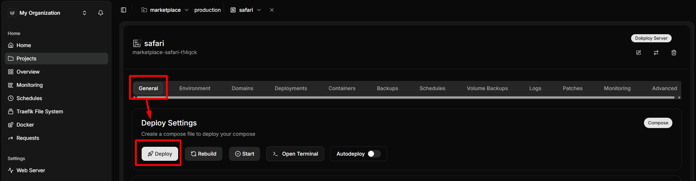
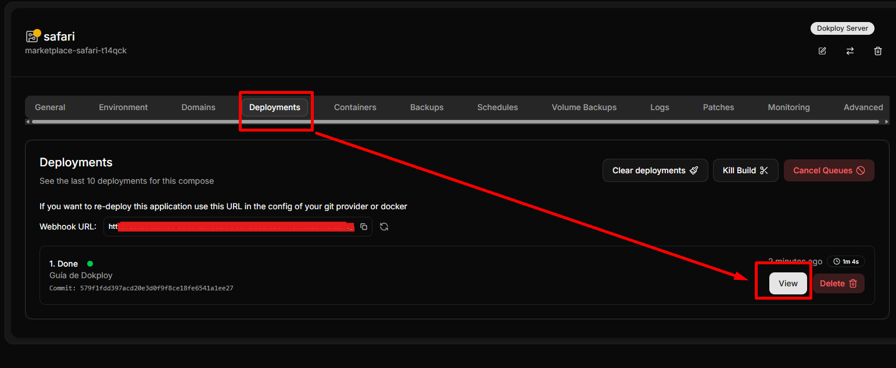
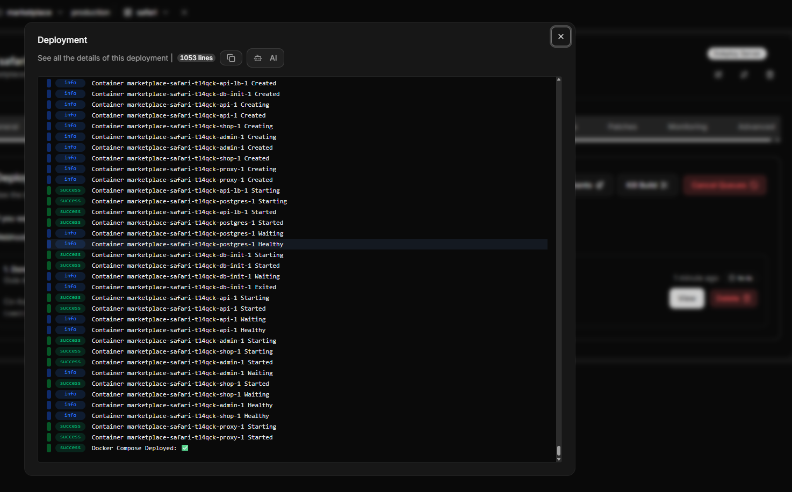
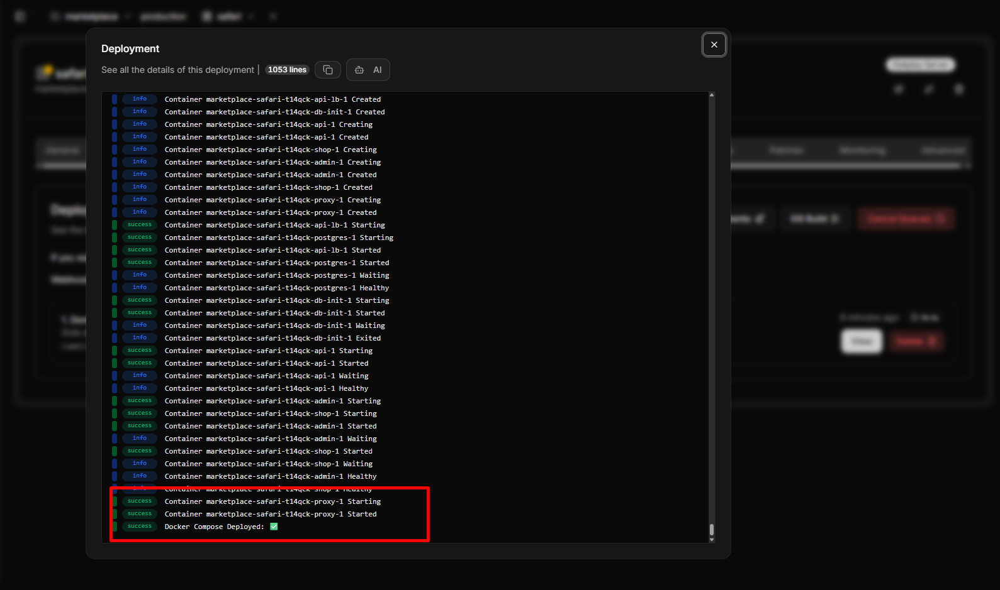
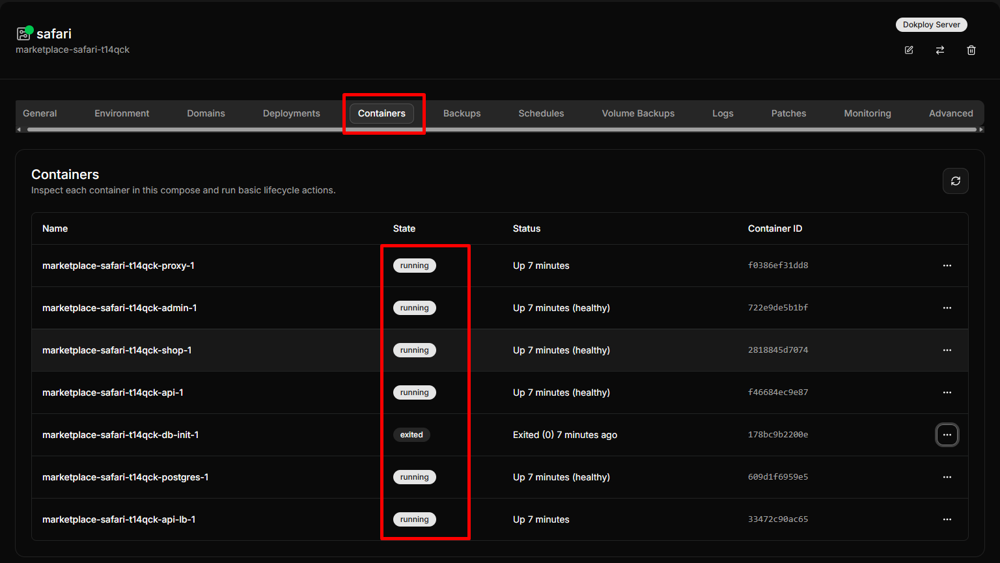
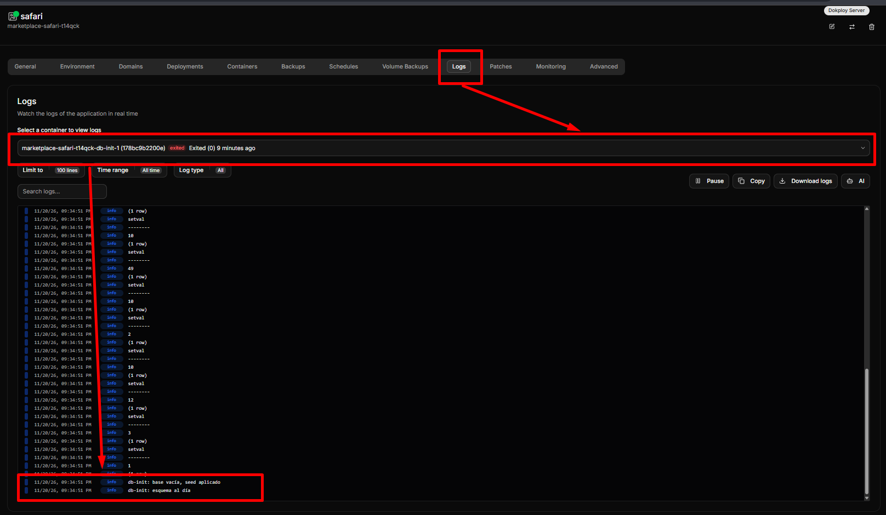
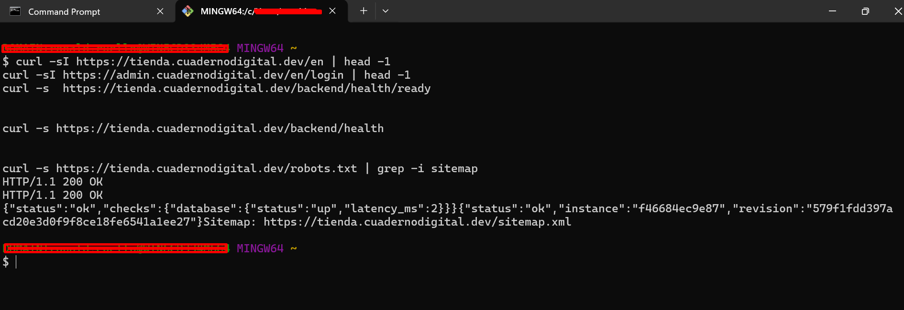
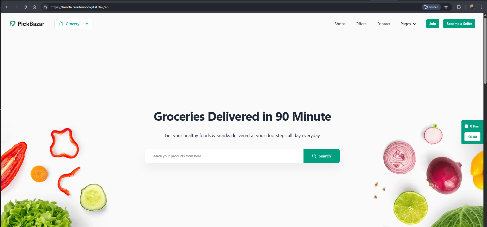
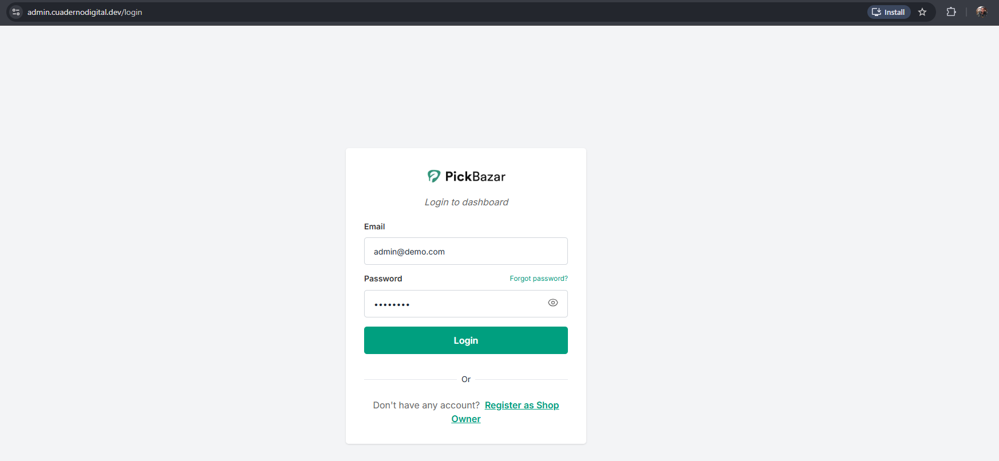
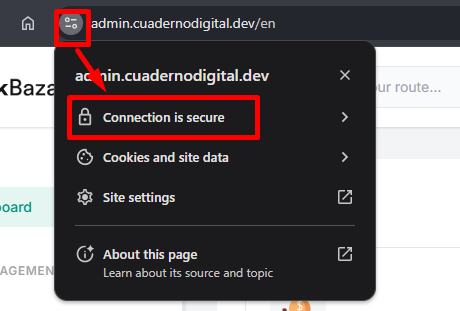

# 08. Desplegar y comprobar

[← 07. Configurar los dominios](07-dominios.md) · [Índice](README.md) · [09. Cambiar las contraseñas demo (obligatorio) →](09-contrasenas-demo.md)

---

## Desplegar

1. En la pestaña **General** del Compose `safari`, pulsa **Deploy** y
   confirma.

   > 
   

2. Entra a la pestaña **Deployments**. El despliegue aparece arriba de la
   lista; pulsa **View** para ver su log en vivo.

   > 

   > 


3. El primer arranque tarda unos minutos: baja las cinco imágenes y crea la
   base. El orden es:

   ```text
   postgres (sano) ─▶ db-init (termina) ─▶ api (sana) ─┬─▶ shop  ─┬─▶ proxy
                                                       └─▶ admin ─┘
   ```

   Cada servicio espera a que el anterior esté sano (o, en el caso de
   `db-init`, a que termine bien). `api-lb` arranca en paralelo.

   El despliegue terminó bien cuando el log cierra sin errores y la lista
   marca el despliegue como **Done**.

   > 

## Revisar los contenedores

4. En la pestaña **Containers**, todos deben estar **running**, salvo
   `db-init`, que termina después de preparar la base (**exited**, con
   código 0). Es lo esperado.

   > 


5. En la pestaña **Logs**, elige el contenedor `db-init`. En el primer
   despliegue aparece:

   ```text
   db-init: base vacía, seed aplicado
   db-init: esquema al día
   ```

   > 


   En los despliegues siguientes dice
   `la base ya tiene datos …, seed omitido`. Los datos iniciales se cargan
   **solo una vez**, y lo que crees o borres después no se pisa.

6. Espera unos segundos a que Traefik emita los certificados de Let's
   Encrypt.

## Comprobar que funciona

Desde tu equipo:

```bash
# La tienda, el admin y la API (por el proxy). Los tres deben dar 200.
curl -sI https://tienda.<tu-dominio>/en | head -1
curl -sI https://admin.<tu-dominio>/en/login | head -1
curl -s  https://tienda.<tu-dominio>/backend/health/ready

# Qué versión corre: «revision» debe ser el commit completo de IMAGE_TAG.
curl -s https://tienda.<tu-dominio>/backend/health

# El sitemap usa tu dominio real.
curl -s https://tienda.<tu-dominio>/robots.txt | grep -i sitemap
```

> 


Después, en el navegador:

- `https://tienda.<tu-dominio>` muestra productos;

  > 
  

- `https://admin.<tu-dominio>` permite entrar con `admin@demo.com` y la
  contraseña demo, que cambias en [09 · Contraseñas demo](09-contrasenas-demo.md);

  > 
  

- el candado del navegador muestra un certificado válido de Let's Encrypt.

  > 
  

Si algo no responde, revisa
[11 · Problemas frecuentes](11-limitaciones-y-problemas.md).

---

[← 07. Configurar los dominios](07-dominios.md) · [Índice](README.md) · [09. Cambiar las contraseñas demo (obligatorio) →](09-contrasenas-demo.md)
