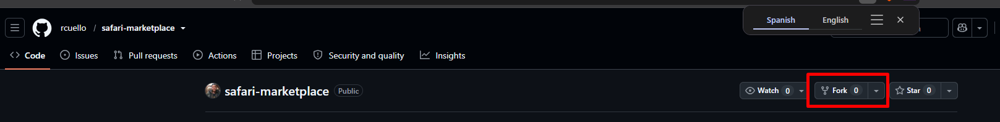
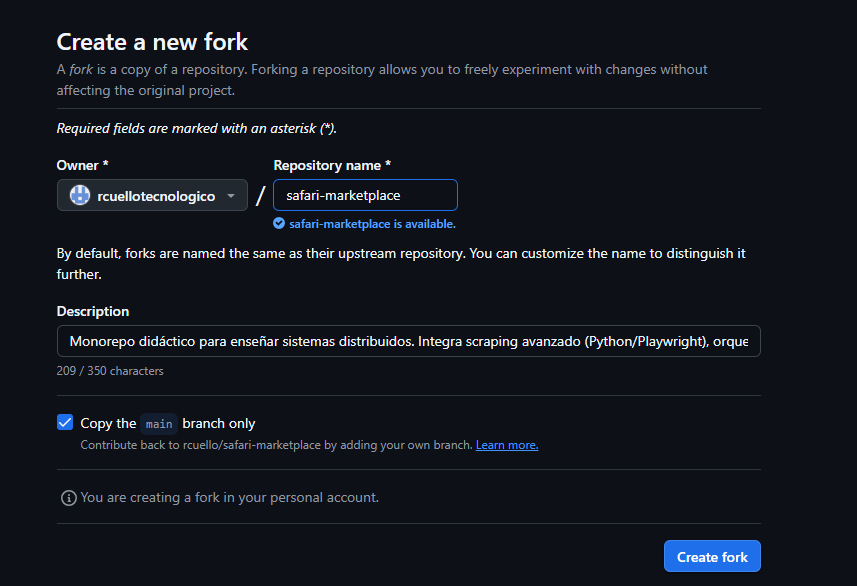
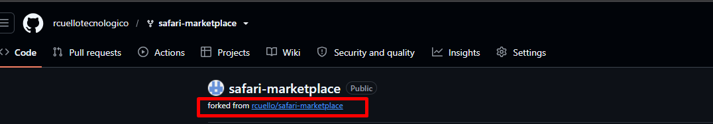
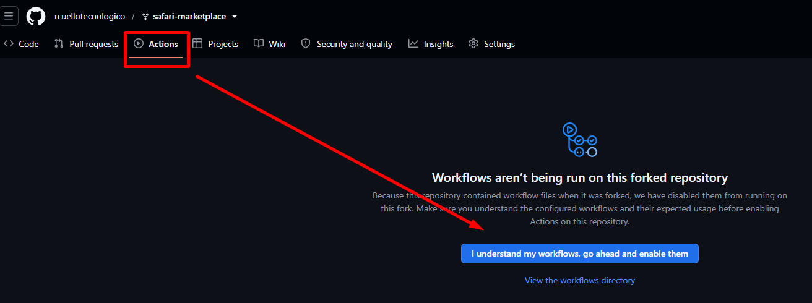
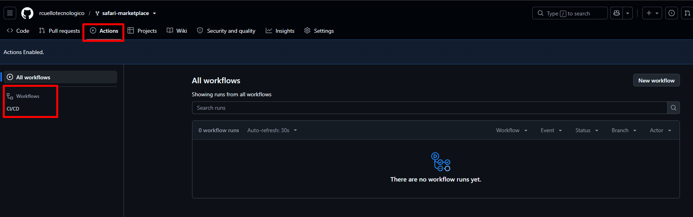
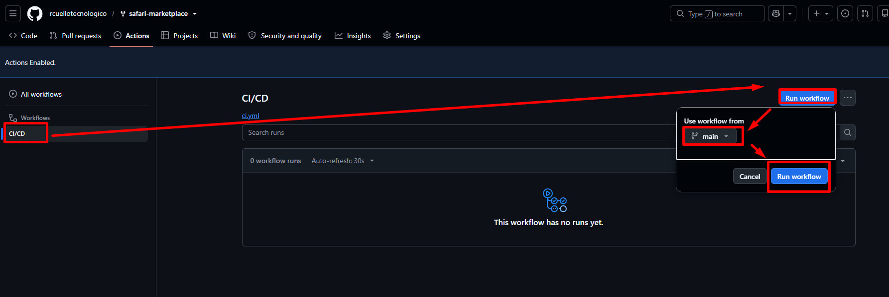
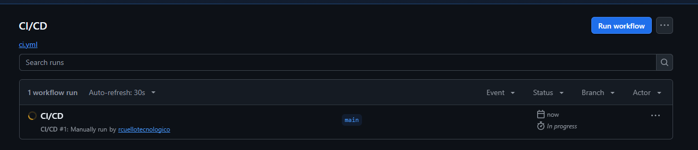
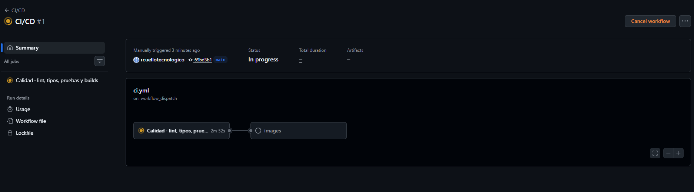
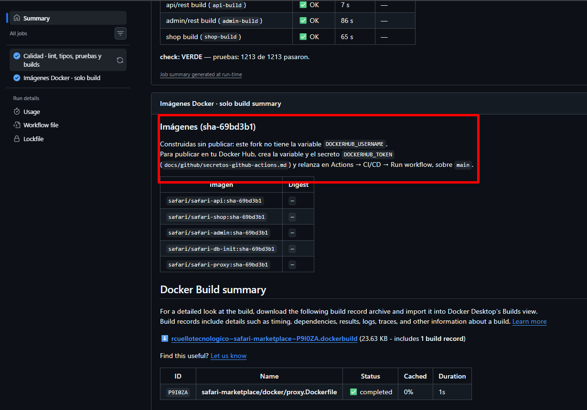
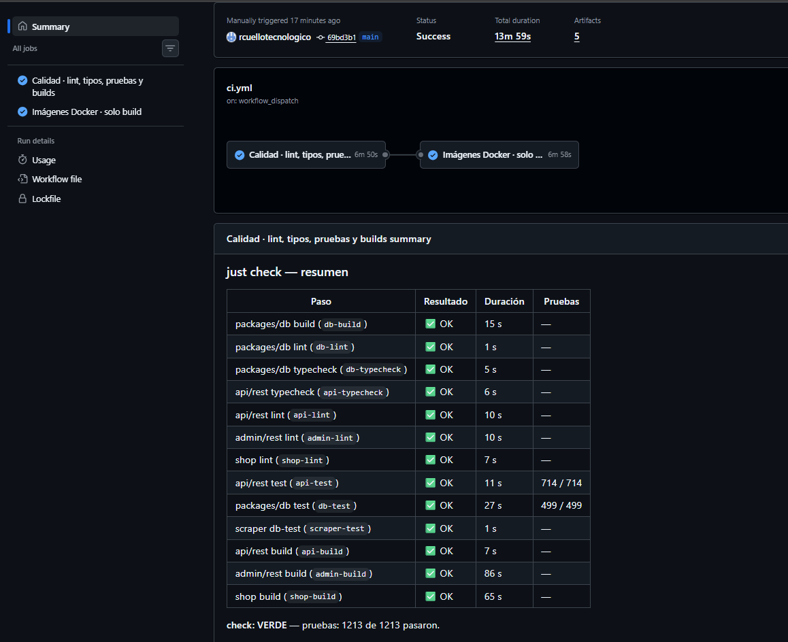

# 01. Crear tu fork y habilitar GitHub Actions

[Índice](README.md) · [02. Secretos y variables de GitHub Actions →](02-secretos-github-actions.md)

---

Un **fork** es tu copia del repositorio en tu cuenta de GitHub. Ahí vas a
trabajar, y su CI va a construir y publicar **tus** imágenes en **tu** Docker
Hub, que es lo que despliega Dokploy.

Al terminar este paso vas a tener:
- tu fork `https://github.com/<tu-usuario>/safari-marketplace`, **público**;
- GitHub Actions habilitado en el fork;
- una primera corrida del CI en verde.

> **El fork tiene que ser público.** Dokploy lo clona en cada despliegue sin
> credenciales. Un fork de un repositorio público ya nace público: no lo
> cambies a privado.

## Crear el fork

1. Entra con tu cuenta de GitHub a
   https://github.com/rcuello/safari-marketplace y pulsa **Fork**, arriba a
   la derecha.

   > 
   

2. Completa el formulario **Create a new fork**:

   | Campo | Valor |
   |---|---|
   | Owner | tu usuario |
   | Repository name | `safari-marketplace` (déjalo así) |
   | Copy the `main` branch only | activado |

   Pulsa **Create fork**.

   > 
   

3. GitHub te lleva a tu fork. Debajo del nombre dice
   **forked from rcuello/safari-marketplace**.

   > 
   

## Habilitar GitHub Actions

GitHub deja los workflows **desactivados** en un fork recién creado, para que
no se ejecute código ajeno sin que lo revises. Hasta que los habilites, el CI
no corre.

4. En tu fork, entra a la pestaña **Actions**. Vas a ver el aviso
   «Workflows aren't being run on this forked repository». Pulsa
   **I understand my workflows, go ahead and enable them**.

   >    

5. La pestaña muestra el workflow **CI/CD** en la lista de la izquierda,
   todavía sin corridas.

   > 

## Lanzar la primera corrida

El CI corre solo con cada push a `main`. Para la primera vez no hace falta
ningún commit: se lanza a mano.

6. En **Actions**, elige **CI/CD** en la lista de la izquierda y pulsa
   **Run workflow**. Deja la rama **main** y pulsa el botón
   **Run workflow**.

   > 

   > 

   > 

   

7. La corrida tarda unos 10 a 15 minutos: primero el job de calidad (lint,
   tipos, pruebas y builds) y después el de imágenes.

   Todavía **no configuraste Docker Hub**, así que el job de imágenes se llama
   **«Imágenes Docker · solo build»**: construye las cinco imágenes, no las
   publica y termina en verde. Al final de la página, el resumen dice:

   ```text
   Construidas sin publicar: este fork no tiene la variable DOCKERHUB_USERNAME.
   ```

   > 

   Es lo esperado. En el [paso 02](02-secretos-github-actions.md) configuras
   Docker Hub y relanzas la corrida para que publique.

   > 

## Con la terminal (opcional)

Con [GitHub CLI](02-secretos-github-actions.md#b1-instalar-github-cli-gh)
instalado y la sesión iniciada:

```bash
# Crear el fork (sin clonarlo todavía)
gh repo fork rcuello/safari-marketplace --clone=false

# Después de habilitar Actions en la web (paso 4), lanzar la primera corrida
gh workflow run ci.yml --ref main --repo <tu-usuario>/safari-marketplace

# Ver cómo va
gh run list --repo <tu-usuario>/safari-marketplace --limit 3
```

Habilitar Actions en un fork se hace desde la web (paso 4).

## Mantener el fork al día

Cuando el repositorio original tenga cambios, tu fork muestra
**This branch is N commits behind**. Para traerlos, pulsa **Sync fork →
Update branch**.

> **Cada sincronización cuenta como un push a `main`:** lanza el CI y, si ya
> configuraste Docker Hub, publica imágenes nuevas con otra etiqueta. Tu
> despliegue no cambia hasta que actualices `IMAGE_TAG` en Dokploy.

---

[Índice](README.md) · [02. Secretos y variables de GitHub Actions →](02-secretos-github-actions.md)
